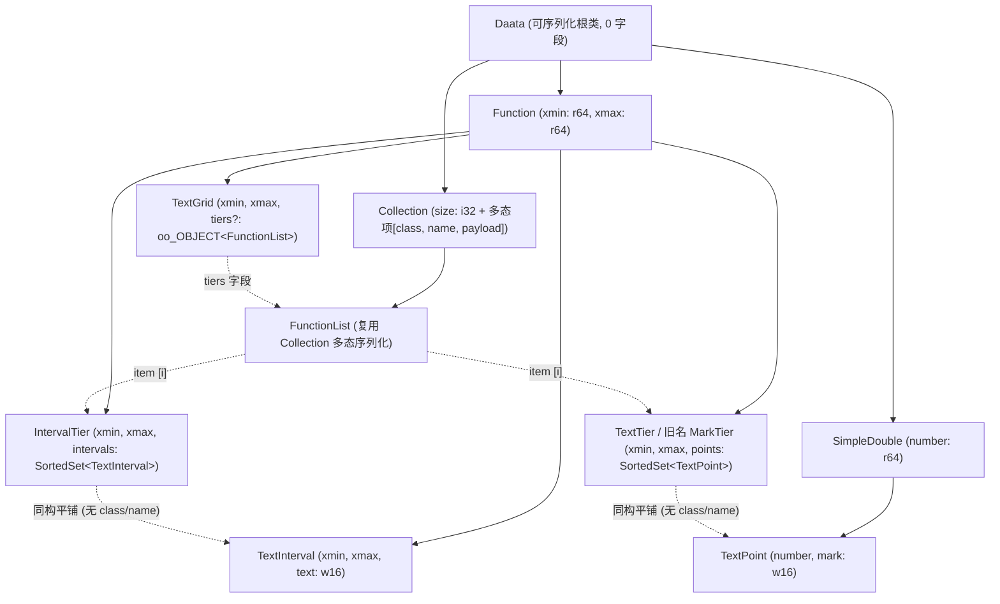

# Praat `.TextGrid` 与 `.Collection` 文件格式完整技术规范

> **文档定位（面向 AI 与工具开发者）**：本规范严格依据标准 Praat 官方 C++ 源码（`melder/`、`sys/`、`fon/`、`kar/`）与官方测试集逆向核验编写，覆盖 `.TextGrid`、独立层文件（`.IntervalTier` / `.TextTier`）及多对象容器 `.Collection` 的**全部序列化变体、字符编码、词法状态机、二进制字节布局、不变量校验与历史兼容细节**。任何 AI 或工程师仅凭本文档即可实现与原生 Praat **100% 双向读写兼容**的解析器、生成器、转换器与校验器。

---

## 目录

1. [架构总览与格式全景矩阵](#1-架构总览与格式全景矩阵)
2. [文件类型自动识别与字符编码规范](#2-文件类型自动识别与字符编码规范)
3. [文本格式底层词法与序列化引擎（`abcio` 状态机）](#3-文本格式底层词法与序列化引擎abcio-状态机)
4. [二进制格式底层原语规范（`ooBinaryFile`）](#4-二进制格式底层原语规范oobinaryfile)
5. [`.TextGrid` 数据模型与五种序列化变体详解](#5-textgrid-数据模型与五种序列化变体详解)
   - 5.1 [类继承体系与精确字段定义](#51-类继承体系与精确字段定义)
   - 5.2 [变体一：标准长文本格式（Long Text）](#52-变体一标准长文本格式long-text)
   - 5.3 [变体二：紧凑短文本格式（Short Text）与混合格式（Hybrid）](#53-变体二紧凑短文本格式short-text与混合格式hybrid)
   - 5.4 [变体三：二进制格式（Binary `ooBinaryFile`）](#54-变体三二进制格式binary-oobinaryfile)
   - 5.5 [变体四：按时间排序文本格式（Chronological TextGrid）](#55-变体四按时间排序文本格式chronological-textgrid)
   - 5.6 [变体五：独立单层文件（Standalone `IntervalTier` / `TextTier`）与超古早遗留格式](#56-变体五独立单层文件standalone-intervaltier--texttier与超古早遗留格式)
6. [`.TextGrid` 领域不变量、容错修复与文本转义语义](#6-textgrid-领域不变量容错修复与文本转义语义)
7. [`.Collection` 多对象容器规范与常见伴随对象（`Sound`）](#7-collection-多对象容器规范与常见伴随对象sound)
8. [参考解析器/生成器算法蓝图（可直接转译代码）](#8-参考解析器生成器算法蓝图可直接转译代码)
9. [AI 实现必读：15 个致命踩坑清单与标准自测用例](#9-ai-实现必读15-个致命踩坑清单与标准自测用例)

---

## 1. 架构总览与格式全景矩阵

### 1.1 核心设计哲学：理解 Praat `oo` 序列化框架

第三方工具解析 `.TextGrid` 与 `.Collection` 最常见的失败原因，是将其误认为类似 INI、YAML 或行正则格式。实际上，Praat 的所有对象持久化建立在统一的 **`Thing` → `Daata`（`oo` 宏对象系统）+ `abcio` 类型驱动流式读写器**之上：

1. **长文本（Long Text）与短文本（Short Text）共享同一个读取函数**：
   Praat 源码中不存在独立的“短文本解析器”。对象的 `v1_readText` 按固定字段顺序依次调用 `texgetr64`（读双精度浮点）、`texgeti32`（读 32 位整数）、`texgetex`（读存在性枚举）、`texgetw16`（读字符串）。所有字段名标签（如 `xmin =`、`intervals [1]:`、`tiers?`）在词法层均被视为**无语法意义的注释词（Label Words）**直接跳过！因此，长文本、短文本、乃至部分带标签部分省略标签的**混合格式（Hybrid Text）**在 Praat 内部完全等价。
2. **`TextGrid.tiers` 本质上就是一个内嵌的 `Collection`**：
   `Collection` 存储一组异构多态 `Daata` 对象（每个元素携带动态 `class` 与 `name`）。而 `TextGrid` 的 `tiers` 字段类型为 `FunctionList`，在 C++ 中直接继承自 `OrderedOf<structFunction>` → `CollectionOf<structFunction>`，**直接复用 `Collection` 的 `v1_readText` / `v1_writeText` / `v1_readBinary` / `v1_writeBinary`**！两者的唯一区别是 `TextGrid.tiers` 外层多包了一层 `oo_OBJECT` 存在性标记（文本为 `tiers? <exists>`，二进制为 `0x01`）。
3. **`IntervalTier.intervals` 与 `TextTier.points` 是同构有序集合（`oo_COLLECTION_OF`）**：
   与多态 `Collection` 不同，`intervals` 与 `points` 已知静态元素类型（分别为 `TextInterval` 与 `TextPoint`），因此**不写存在性标记，也不为每个元素写 `class` 和 `name`**，仅输出元素数量 `size` 后直接平铺各元素字段；且读取时底层容器 `SortedSetOfDoubleOf` 会**自动按时间戳排序并静默丢弃重复起点/时间点的元素**。



### 1.2 支持变体全景矩阵

一个“完全支持 `.TextGrid` 与 `.Collection`”的工具应当识别并处理以下全部格式变体：

| 文件/格式变体 | 顶层魔数 / 首行特征 | 适用对象 | 读写要求建议 |
| :--- | :--- | :--- | :--- |
| **Long Text（标准长文本）** | 首行含 `ooTextFile`（标准写出：`File type = "ooTextFile"`） | `TextGrid`、`Collection`、`IntervalTier`、`TextTier` 等全部 `Daata` | **必选读写**（最通用默认格式） |
| **Short Text（紧凑短文本）** | 首行**同样**为 `File type = "ooTextFile"`（或简写 `"ooTextFile"`），正文无字段名 | 同上 | **必选读取，推荐支持写出**（同一词法器天然兼容） |
| **Hybrid Text（混合文本）** | 首行含 `ooTextFile`，正文混用注释、多值同行、部分标签 | 手工编写或第三方工具生成的 `TextGrid` / `Collection` | **必选读取**（使用 `abcio` 状态机即可零成本兼容） |
| **Binary（二进制格式）** | 前 12 字节固定为 ASCII `"ooBinaryFile"` | 同上（`Save as binary file...`） | **必选读取，推荐支持写出**（大文件/工程打包核心格式） |
| **Chronological TextGrid（时间序文本）** | 首字节起精确匹配含双引号的 `"\"Praat chronological TextGrid text file\""` | 仅 `TextGrid`（`Save as chronological text file...`） | **必选读取，可选写出** |
| **Gzip 压缩文本（`.TextGrid.gz`）** | 前 2 字节为 `0x1F 0x8B` | 常见于大型语音语料库（如 CGN 语料库） | **推荐读取**（解压后走文本解析管线） |
| **Legacy Pre-oo 格式（Praat < 3.x 古早格式）** | 首行含 `<Class>TextFile` 或头部含 `<Class>BinaryFile` | 极早期历史语料文件（`formatVersion = -1`） | 可选读取兼容（见 §5.6 与 §7.2） |

---

## 2. 文件类型自动识别与字符编码规范

### 2.1 顶层文件识别流水线（对齐 `Data_readFromFile`）

当工具打开任意未知输入文件（无论扩展名是 `.TextGrid`、`.Collection` 还是无扩展名）时，应按以下严格优先级探测容器类型：

1. **读取文件头部最多前 512 字节** `header[0 .. nread-1]`：
2. **Gzip 压缩流检测**：
   - 若 `nread > 9` 且 `header[0] == 0x1F && header[1] == 0x8B`：先执行 Gzip 解压，再将解压后的字节流送入**文本解析管线（`Data_readFromTextFile`）**。
   - > **Praat 源码行为注记**：Praat 原生 `MelderReadText.cpp` 解压 `.gz` 时读取末尾 4 字节 `ISIZE` 作为解压长度，且硬编码按 `WINDOWS_LATIN1`（CP1252）解码、跳过了 BOM 剥离和 `\r` 归一化。第三方工具解压 `.gz` 后**建议执行完整的 BOM + UTF-8/CP1252 自动检测与换行归一化**，兼容性优于原生 Praat。
3. **文本容器检测（`ooTextFile` / 8-bit / UTF-8 / UTF-16）**：
   - **8-bit / UTF-8 路径**：若 `nread > 11`，在 `header`（以首个 `0x00` 截断为 C 字符串）中查找子串 `"TextFile"`（长 8）或 `"Text2File"`（长 9）。若命中位置 `offset < nread - len` 且 `offset < 40`，判定为**文本容器**。（注：若有 3 字节 UTF-8 BOM `EF BB BF`，`File type = "ooTextFile"` 中 `"TextFile"` 位于字节偏移 `18`，满足 `< 40`。）
   - **UTF-16 BE/LE 路径**：若 `nread > 22`，取前 `min(nread, 100)` 字节副本，将其中所有 `0x00` 字节替换为 `0x01`，查找 15 字节特征串 `"T\x01e\x01x\x01t\x01F\x01i\x01l\x01e"`。若命中位置 `offset < nread - 15` 且 `offset < 80`，判定为**文本容器**（同时匹配 UTF-16BE 与 UTF-16LE）。
4. **二进制容器检测（`ooBinaryFile`）**：
   - 若 `nread > 13`，在 `header` 中查找 `"BinaryFile"`（长 10）或 `"Binary2File"`（长 11）。若命中位置 `offset < nread - len` 且 `offset < 40`，判定为**二进制容器**。
5. **专有格式识别器（Chronological TextGrid）**：
   - 检查解码后的首行（或原始头部）是否以 `"\"Praat chronological TextGrid text file\""`（含英文双引号，共 40 个 ASCII 字符）开头。
   - > **重要兼容性陷阱**：原生 Praat 的 `chronologicalTextGridTextFileRecognizer` 有两个苛刻限制：① **要求文件总字节数 `nread >= 100`**（小于 100 字节的极短文件在 Praat 中自动识别会失败！）；② UTF-8 模式下直接比对 `header[0..39]`，**若带 UTF-8 BOM (`EF BB BF`) 会导致原生 Praat 无法识别**！因此：**读取器**应放宽这两个限制（允许 `< 100` 字节且兼容 BOM）；**写出器**生成 Chronological 格式时**严禁写入 UTF-8 BOM**。
6. **纯可打印 ASCII 单行兜底**：
   - 若 `header[0 .. nread-1]` 全部字节均在 `32..126` 范围内（无 `\r`、`\n`、`\t`），Praat 也会回退送入文本解析管线。

### 2.2 文本编码检测与换行符规范

#### 读取端编码自动检测（对齐 `MelderFile_readText` + `MelderReadText`）

| 优先级 | 字节特征 | 解码规则 |
| :---: | :--- | :--- |
| **1** | 前 2 字节为 `0xFE 0xFF` | **UTF-16BE**（剥离 2 字节 BOM，按大端序 `uint16` 读取并解码 UTF-16 代理对；孤立代理项替换为 `U+FFFD`）。 |
| **2** | 前 2 字节为 `0xFF 0xFE` | **UTF-16LE**（剥离 2 字节 BOM，按小端序 `uint16` 读取并解码 UTF-16 代理对）。*注：Praat 不支持 UTF-32！* |
| **3** | 前 3 字节为 `0xEF 0xBB 0xBF` | 剥离 3 字节 BOM，后续字节进入下方第 4 步 8-bit/UTF-8 判定。 |
| **4** | 无 BOM（或剥离 UTF-8 BOM 后） | 先剔除流中意外出现的 `0x00` 字节（*注：因此 Praat 字符串内严禁包含 `U+0000` NUL 字符；第三方工具若检测到无 BOM 的 UTF-16 `00 xx` / `xx 00` 交替特征，可优先按无 BOM UTF-16 解码以增强容错，但原生 Praat 要求 UTF-16 必须带 BOM*）。接着对全文件做 **UTF-8 合法性校验**（原生 `Melder_str8IsValidUtf8` 校验引导字节与续字节位模式 `0x00..0x7F`、`0xC2..0xDF`+1、`0xE0..0xEF`+2、`0xF0..0xF4`+3；第三方读取器推荐采用标准严格 UTF-8 校验）：<br>• **全部合法** → 按 **UTF-8** 解码。<br>• **存在非法 UTF-8 字节** → 回退为单字节编码：Windows 默认按 **Windows-1252（CP1252）** 解码（其中未定义字节 `0x81, 0x8D, 0x8F, 0x90, 0x9D` 保持恒等映射），macOS 默认 **MacRoman**，Linux 默认 **ISO-8859-1**。跨平台工具推荐默认回退 **Windows-1252**（超集兼容 ISO-8859-1 的可打印区）。 |

#### 换行符归一化与写出规范

- **读取归一化**：词法扫描前（包括字符串字面量内部！），必须将所有 `\r\n`（`0D 0A`）及独立 `\r`（`0D`，经典 Mac 换行，官方测试集 `test.FujisakiPitch` 实测存在）统一归一化为单个 `\n`（`U+000A`）。在 UTF-16 路径下，Praat 还将 `\r + U+0085`、`U+0085`（NEL）、`U+000C`（FF）、`U+2028`（LS）、`U+2029`（PS）全部归一化为 `\n`。
- **写出编码与换行**：
  - **推荐默认写出编码**：**UTF-8（无 BOM）**（这也是原生 Praat 的默认设置 `kMelder_textOutputEncoding::UTF8`）。若用户显式要求 UTF-16，必须写出 **UTF-16BE + `0xFE 0xFF` BOM**（Praat 从不写出 UTF-16LE）。
  - **写出换行符**：Praat 在 Windows 上写出 `\r\n`，在 macOS/Linux 上写出 `\n`；两者均被所有平台 Praat 无缝读取，工具默认输出 `\n`（或跟随平台）均可。

### 2.3 文本容器头部解析与类名版本号拆分（`Data_readFromTextFile`）

1. 读取第一行 `line1`（不含换行符；注意 `ooTextFile` 所在的第一行会被整行消费，因此第二个双引号类名 Token **必须从第 2 行或更后行开始**，不可与 `ooTextFile` 挤在同一行）：
   - 若包含子串 `"ooText2File"` → 报错拒绝（未来不兼容版本）。
   - **标准路径**：若 `line1` 任意位置包含子串 `"ooTextFile"`（因此 `File type = "ooTextFile"`、裸 `"ooTextFile"`、甚至部分第三方工具写的 `File type = "ooTextFile short"` **全部合法**！）：
     - 调用下节的 `abcio` 字符串读取器 `texgetw16` 读取下一个双引号字符串作为 `classToken`（中间的 `Object class = ` 或注释会被自动跳过）。
     - 在 `classToken` 中查找**第一个 ASCII 空格 `' '` (`0x20`)**：
       - 无空格：`className = classToken`，`formatVersion = 0`（例如 `"TextGrid"`、`"Collection"`）。
       - 有空格：空格前为 `className`（**大小写严格敏感**），空格后按十进制整数解析为 `formatVersion`（例如 `"Sound 2"` → `className = "Sound"`, `formatVersion = 2`）。
   - **古早遗留路径（Pre-oo）**：若不含 `"ooTextFile"` 但包含 `"TextFile"`（如首行为 `"TextGridTextFile"`）：
     - 截取 `"TextFile"` 之前的前缀作为 `className`，并令 `formatVersion = -1`。
2. 实例化对应类，校验 `formatVersion <= classInfo.version`（针对所有 `oo_DEFINE_CLASS` 类，若文件中的版本大于当前支持的最高版本则报错），调用 `v1_readText(text, formatVersion)`，最后调用 `v_repair()` 执行加载后自愈。

---

## 3. 文本格式底层词法与序列化引擎（`abcio` 状态机）

> **本章是实现 100% 兼容解析器的灵魂**。切勿按行切分或按 `=` 切分 `.TextGrid` / `.Collection` 文本文件！请直接实现下述基于期望类型的流式词法扫描器。

### 3.1 空白字符集定义（`Melder_isHorizontalOrVerticalSpace`）

Praat 认定的空白字符共 **25 个 Unicode 码点**：
- **ASCII 空白（6 个）**：`\t` (`U+0009`)、`\n` (`U+000A`)、`\v` (`U+000B`)、`\f` (`U+000C`)、`\r` (`U+000D`)、空格 `' '` (`U+0020`)。
- **Unicode 分隔符（19 个）**：`U+0085`、`U+00A0`、`U+1680`、`U+2000`..`U+200A`（共 11 个）、`U+2028`、`U+2029`、`U+202F`、`U+205F`、`U+3000`（全角空格）。
- EOF（文件结束）**不是**空白字符。

### 3.2 类型驱动的前导跳过状态机（为什么长/短文本完全通用）

每当结构化模式需要读取下一个字段时，调用方**静态已知期望的词法类型** $T \in \{\text{Integer}, \text{Unsigned}, \text{Real}, \text{Enum}, \text{String}\}$。各类型的**合法起始字符集**与**错误类型拦截字符集**如下表：

| 期望词法类型 $T$ | 合法起始字符（进入值解析） | 错误类型首字符（立即抛错拒绝！） | 其余任何非空白首字符（如字母、`=`、`?`、`[`、`:`、`(`、`.`） |
| :--- | :--- | :--- | :--- |
| **`Integer` / `Real`** | `'0'..'9'`, `'+'`, `'-'` | `'\"'`, `'<'` | 视为注释/标签词：**连续吞掉整个非空白词直至遇到空白字符**！ |
| **`Unsigned`** | `'0'..'9'`, `'+'` | `'-'`, `'\"'`, `'<'` | 同上，吞掉整个非空白词直至空白字符 |
| **`Enum`** (`eb`/`eq`/`ex`/`e8`/`e16`) | `'<'` | `'0'..'9'`, `'+'`, `'-'`, `'\"'` | 同上，吞掉整个非空白词直至空白字符 |
| **`String`** (`w16`/`w32`) | `'\"'` | `'0'..'9'`, `'+'`, `'-'`, `'<'` | 同上，吞掉整个非空白词直至空白字符 |

#### 前导扫描精确循环步骤

在读取任何类型的字段值前，循环执行：
1. 读取下一个字符 `c`；若到达 EOF，抛出 `Early end of text` 错误。
2. 若 `c` 属于空白字符集，继续步骤 1。
3. 若 `c == '!'`：**行尾注释**！连续读取字符直至遇到 `\n` 或 `\r`（原生 Praat 若在 `!` 注释行未见换行直接遇到 EOF 会报 `Early end of text`，第三方读取器可兼容 `! ... EOF`，但写出器必须在注释后输出换行），然后继续步骤 1。
4. 若 `c` 属于当前期望类型 $T$ 的**合法起始字符**：跳出前导循环，进入 §3.3 对应的值解析逻辑！（*特例*：在 `Real` 模式中，若读到孤立的 `'+'` 且紧跟空白或 EOF，Praat 会忽略该 `'+'` 并重新进入步骤 1。）
5. 若 `c` 属于当前期望类型 $T$ 的**错误类型首字符**：立即抛出类型不匹配语法错误（例如期望字符串却遇到裸数字 `class = 666 "IntervalTier"`，不能跳过 `666`，必须报错！）。
6. **否则（普通标签词跳过）**：循环读取字符直至遇到空白字符（若在遇到空白前到达 EOF，抛出 `Early end of text`），然后回到步骤 1。

#### 这一状态机带来的 4 条关键推论（必读！）

1. **为什么 `intervals [1]:` 中的 `1` 不会被误读为数字？**
   因为 `[1]:` 的首字符是 `'['`（不是数字），步骤 6 会把整个非空白串 `[1]:` 一次性吞掉直到末尾换行！同理 `tiers?`、`xmin`、`=`、`item`、`[]:`、`(empty)` 全部被步骤 6 静默跳过。
2. **`=` 号后面必须有空白字符！**
   若写成紧凑无空格的 `xmin=0` 或 `text="hi"`，词首字符是 `'x'` / `'t'`，步骤 6 会把整串 `xmin=0` / `text="hi"` 当作一个普通标签词全部吞掉，导致真正的值丢失！**写出长文本时，`=` 与值之间必须留空格。**
3. **`!` 注释与引号/尖括号拦截仅在“空白后的词首”触发**：
   像 `foo!bar`、`foo"bar`、`foo=123` 这样紧贴在字母后面的字符，因词首是 `'f'`，会被整词跳过（`foo!bar` 不会触发行注释）。而独立词 `! comment with "quotes" and 123` 因 `'!'` 在词首，会安全跳过整行。
4. **自定义注释/标签词严禁以 `0-9`、`+`、`-`、`"`、`<` 开头**（除非前面有空格分隔的 `!`）。

### 3.3 五类原语的值解析与写出规则

#### 1. 字符串（`String`：`texgetw16` / `texputw16`）

- **定界符**：以 ASCII 双引号 `"` (`U+0022`) 开始，以未成对的 `"` 结束；长度无上限。
- **唯一转义规则——双引号翻倍（`""`）**：
  - 字符串内部表示字面量双引号 `"` 时，**必须且只能写成两个连续双引号 `""`**！
  - 例如：内容为 `ad"ta"`，在文件中写作 `"ad""ta"""`（首尾为定界引号，中间两处 `""` 各解码为一个 `"`）。
- **反斜杠 `\` 没有任何词法转义含义（极易踩坑！）**：
  - `\` 只是普通字符！在 Praat 文本文件中写 `"a\"b"` 会导致解析器在 `\` 后读到单个 `"` 视为字符串结束，紧接着看到字符 `'b'` 非空白，**直接抛出语法错误** `Character b following quote`！
  - 内容为 `a\` 的字符串在文件中直接写作 `"a\"`（后跟换行或空格），完全合法！
  - 内容为 `\"`（反斜杠加双引号）的字符串在文件中必须写作 `"\"""`。
- **闭合引号后的强制分隔符**：
  - 闭合 `"` 之后的下一个字符**必须是空白字符或 EOF**（若是空白字符则顺带消费掉该字符）；若紧跟任何非空白字符（如 `"ad"x`、`"ad"!comment`、`"ad",`），**必须报错**！
- **多行字符串原生支持**：
  - 引号对 `"..."` 内允许直接包含真实换行符（含连续空行），读取时在换行归一化后原样保留为字符串内的 `\n`（`U+000A`）。
- **空指针写出**：内存中为空指针时写出 `""`。

#### 2. 实数 / 双精度浮点数（`Real`：`texgetr64` / `texputr64`）

- **Token 截取**：从合法首字符（`0-9`、`+`、`-`）起连续读取非空白 ASCII 字符（`<= 127`），**最长 40 字节**（超过 40 个非空白字符或含非 ASCII 字符直接报错），遇空白或 EOF 结束。
- **有理数分数支持**：若 Token 中包含 `'/'`（如 `1/3`），按首个 `'/'` 拆分为分子和分母分别按下方 `Melder_a8tof` 解析并相除；若任一方为 `undefined` 或分母为 `0.0`，结果为 `undefined`（`NaN`）。
- **`Melder_a8tof` 数值解析规则**：
  - 可选正负号 `[+-]` 后**紧邻的第一个字符必须是数字 `'0'..'9'`**！若不是数字，**不抛异常，而是返回 `undefined`（IEEE-754 `NaN`）**！
    - 这正是 Praat 解析 `--undefined--` 的机制：首字符为 `'-'` 进入 `getReal`，整词 `--undefined--` 读入缓冲区；随后第二个字符还是 `'-'`（非数字），于是返回 `undefined`（`NaN`）！
    - 同理：`+inf`、`-inf`、`+nan`、`-nan` 均返回 `undefined`；而无符号裸写的 `inf` 或 `nan` 因首字符为 `'i'`/`'n'`，会被前导扫描器当作标签词跳过（因此**严禁写出 `nan` 或 `inf`！未定义值必须且只能写出 `--undefined--`**）。
    - 注意：无前导零的小数（如 `.5`）首字符是 `'.'`，会被当作标签词跳过！**写出小数时小数点前必须有数字（如 `0.5`）**。
  - 支持十进制与科学计数法：`[+-]?[0-9]+(\.[0-9]*)?([eE][+-]?[0-9]+)?%?`（允许 `1.`；若尾部带 `%` 则将数值乘以 `0.01`；若 `e`/`E` 后无数字则返回 `undefined`）。
  - 支持 C99 十六进制浮点字面量：`[+-]?0[xX][0-9a-fA-F]+(\.[0-9a-fA-F]*)?([pP][+-]?[0-9]+)?`。
- **写出精度规范（`Melder_double`）**：
  - 若值为 `NaN` 或 `±Inf`（`isundef(x)`）：写出字面量 `--undefined--`。
  - 否则使用 C 语言区域（小数点固定为 `'.'`），依次尝试 `%.15g`、`%.16g`、`%.17g`：选择**经 `strtod` 回读后与原 `double` 逐比特相等（`==`）的最短十进制表示**（例如 `0` 输出 `0`，`2.3` 输出 `2.3`，`0.5051115439848715` 保留 16 位有效数字确保无损往返）。
  - 单精度 `texputr32` 固定使用 `%.9g`（TextGrid 与 Collection 的文本模式均使用 `r64`）。

#### 3. 整数（`Integer` / `Unsigned`：`texgeti32`、`texgetinteger` 等）

- **Token 截取**：最长 40 个 ASCII 字符，不支持十六进制前缀。（*注：原生 Praat 调用 `strtoll(buffer, nullptr, 10)` 时未检查 `endptr`，遇到 `"12abc"` 会静默截断为 `12`、遇到 `"-"` 会得到 `0`；但规范的第三方解析器与写出器应严格要求整词匹配十进制整数正则 `^[+-]?[0-9]+$`，并在所有容器 `size` 字段上校验 `size >= 0`。*）
- **精确值域校验**：
  - `i8`：`-128 .. 127` | `u8`：`0 .. 255`
  - `i16`：`-32768 .. 32767` | `u16`：`0 .. 65535`
  - `i32` 及 **`integer`（含 `oo_INTEGER`、`oo_COLLECTION` 的 `size`）**：在所有 32/64 位平台上**严格限制为有符号 32 位整数 `-2147483648 .. 2147483647`**（`INT32_MIN .. INT32_MAX`）！Praat 不存在 64 位整数序列化原语。

#### 4. 枚举、布尔与存在性标记（`Enum`：`texgetex`、`texgeteb`、`texgeteq`、`texgete8`）

- **语法**：以 `<` 开始，读取至 `>` 结束；尖括号内部**最长 39 个字符**（达到 40 字符立即报错）。
- **内部字符限制**：`<...>` 内部允许出现普通 ASCII 空格 `' '` (`0x20`)，但若出现 `\t`、`\n`、`\r` 等任何其他空白字符或 EOF 则报错。
- **闭合 `>` 后规则**：读到 `>` 即刻停止返回，**不要求也不消费 `>` 后面的空白字符**（与闭合双引号 `"` 不同）。
- **大小写匹配规则**：**仅首字母大小写不敏感，第 2 个字符起严格区分大小写**！（例如 `<exists>` 与 `<Exists>` 合法，`<EXISTS>` 非法报错。）
- **内置布尔/存在性词表与长文本写出格式**：
  - **`ex`（`oo_OBJECT` 子对象存在标记，如 `TextGrid` 中的 `tiers`）**：`<absent>` (`0`) / `<exists>` (`1`)。长文本写出格式为：`<字段名>? <exists> `（注意是问号 `? `，**没有等号 `=`**！）。
  - **`eq`（`oo_QUESTION`）**：`<no>` (`0`) / `<yes>` (`1`)。长文本写出：`<字段名>? <yes> `。
  - **`eb`（`oo_BOOLEAN`）**：`<false>` (`0`) / `<true>` (`1`)。长文本写出：`<字段名> = <true> `。
  - **`e8` / `e16`（`oo_ENUM`）**：`<枚举名>`。长文本写出：`<字段名> = <枚举名> `。

#### 5. 长文本与短文本排版的精确格式细节（供写出器对齐原生字节流）

- **顶层文件头（Long Text 与 Short Text 完全一致！）**：
  ```text
  File type = "ooTextFile"
  Object class = "<ClassName>"
  ```
  > **源码级纠偏**：Praat 头文件 `sys/Data.h` 注释曾误写短文本头部为 `File type = "ooTextFile short"`，但实际实现 `sys/Data.cpp:_Data_writeToTextFile` 中**长文本和短文本写出完全相同的上述两行头部**！
- **第 3 行恒为空行**：第 2 行末尾有 `\n`，而每个 `texput*` 与 `texputintro` 都在行首前置输出 `\n`，自然形成第 3 行空行；文件最末尾还会额外追加一个 `\n`。
- **缩进与行尾空格规则**：
  - **长文本（`verbose = true`）**：每层 `texputintro` 缩进递增 **4 个空格**，`texexdent` 递减 4 个空格。每一行**带值的 `texput*` 行末尾都带 1 个尾随 ASCII 空格 `' '`**；而分组引导行 `texputintro`（如 `    item [1]:`、`        intervals [1]:`）末尾**没有**尾随空格——唯独 `Collection` 顶层的 `item []: ` 字符串本身包含 1 个尾随空格（当 `size == 0` 时输出 `item []: (empty)`，无尾随空格）。
  - **短文本（`verbose = false`）**：`texputintro` 不产生任何输出；每个 `texput*` 独占一行，无缩进、无字段名、无 `=`/`?`、无尾随空格，仅输出裸值。

---

## 4. 二进制格式底层原语规范（`ooBinaryFile`）

**全局字节序铁律**：Praat 的 `ooBinaryFile` 内**所有多字节整数、IEEE-754 浮点数及 UTF-16 代码单元一律采用大端序（Big-Endian / 网络字节序，MSB 在前）**。

### 4.1 顶层文件头结构（`Data_writeToBinaryFile` / `Data_readFromBinaryFile`）

| 偏移 | 长度 | 类型 | 内容说明 |
| :---: | :---: | :---: | :--- |
| `0x00` | 12 B | Raw ASCII | 固定魔数 `"ooBinaryFile"`（`6F 6F 42 69 6E 61 72 79 46 69 6C 65`，**无 NUL 结尾，无换行**） |
| `0x0C` | $1 + L$ B | `w8` / `s8` | 顶层类名与版本号字符串：`[uint8 L]` + `L` 个 ASCII 字节。例如 `"TextGrid"` 为 `08 54 65 78 74 47 72 69 64`（共 9 字节）；`"Collection"` 为 `0A 43 6F 6C 6C 65 63 74 69 6F 6E`（共 11 字节）；`"Sound 2"` 为 `07 53 6F 75 6E 64 20 32`（共 8 字节）。 |
| `0x0D + L` | 变长 | Payload | 紧接顶层对象的 `v1_writeBinary` 二进制载荷直至 EOF。 |

*(注：若为 Praat < 3.x 古早二进制文件，无 `"ooBinaryFile"` 前缀，而是直接以 ASCII `"<ClassName>BinaryFile"` 开头，`formatVersion = -1`。) *

### 4.2 数值、布尔与枚举原语字节表

| 原语名称 | 字节数 | 编码规则与陷阱说明 |
| :--- | :---: | :--- |
| `u8` / `i8` | 1 B | 无符号 `0..255` / 有符号补码 `-128..127` |
| `u16` / `i16` (`integer16BE`) | 2 B | 大端序无符号 / 有符号补码整数 |
| `i24` | 3 B | 大端序 24 位有符号补码整数 `-8388608..8388607` |
| `u32` / `i32` (`integer32BE`) | 4 B | 大端序无符号 / 有符号补码整数（所有 `size`、`nx`、`ny`、`oo_INTEGER` 均为 4B `i32`！） |
| **`eb` / `eq` / `ex` (`bool8`)** | **1 B** | **致命源码注释陷阱纠偏**：`sys/oo.h` 注释声称其值为 `170/185`、`150/165`、`226/241`，**该注释已废弃且完全错误**！真实 `abcio` 实现统一映射为 `bool8`：**写出固定为 `0x00`（假/`absent`）或 `0x01`（真/`exists`）**；读取时 `0x00` 为假，任何非零字节 `0x01..0xFF` 为真。 |
| `e8` / `e16` | 1 B / 2 B | 枚举整数值（1B 有符号字节 / 2B 大端有符号整数），读取时校验枚举上下界 |
| `r32` | 4 B | IEEE-754 binary32 大端序单精度浮点数 |
| `r64` | 8 B | IEEE-754 binary64 大端序双精度浮点数 |
| `r80` | 10 B | Motorola/Apple 80-bit IEEE 扩展精度大端序浮点数（1B 符号+阶码高位，1B 阶码低位，偏置 16383，8B 含显式整数位的尾数） |
| `c64` / `c128` | 8 B / 16 B | `[r32 real][r32 imag]` / `[r64 real][r64 imag]` 大端序复数 |

> **二进制浮点 `undefined` 语义**：读取 `r32` / `r64` / `r80` 时，只要指数位全为 `1`（即**无论 `±Inf` 还是任何 `NaN`**），一律映射为 Praat 的 `undefined`（内存 `NaN`）。写出 `undefined` 时，写静默 `NaN`（`7F F8 00 00 00 00 00 00`）或正无穷 `+Inf`（`7F F0 00 00 00 00 00 00`）在全平台 Praat 中均可无损回读。

### 4.3 二进制字符串原语（`w8` / `w16` / `w32` 的 `0xFFFF` 转义与码点计数陷阱！）

Praat 中所有文本标签、对象名称、`TextInterval.text`、`TextPoint.mark` 在 `oo` 中均声明为 `oo_STRING`，对应 **`w16`**（少数超长字符串用 `oo_LSTRING` = `w32`，类名用 `w8`）。

> **源码注释二次纠偏**：`melder/abcio.h` 注释误写二进制宽字符串为 `"UTF-16LE"`，**实际 `abcio.cpp` 读写全部是大端序 UTF-16BE**！

设长度前缀整数宽度 $W$ 与全 1 转义哨兵值 $\text{ESC}$ 如下：
- `w8`：$W = \text{uint8}$（1B），$\text{ESC} = \text{0xFF}$（最大字符数 254）
- **`w16`（最常用）**：$W = \text{uint16 BE}$（2B 大端），$\text{ESC} = \text{0xFFFF}$（最大码点数 65534）
- `w32`：$W = \text{uint32 BE}$（4B 大端），$\text{ESC} = \text{0xFFFFFFFF}$（最大码点数 4294967294）

#### 编码与解码双路径规则

1. **纯 ASCII 快速路径（所有码点 $\le \text{0x7F}$，含空串 `""`）**：
   - **写出**：`[W(N)]` + `N` 个原始单字节 ASCII 字符（无结尾 `\0`；空串仅写 `00 00`）。
   - **读取**：若首个整数 $L \ne \text{ESC}$，直接读取 $L$ 个单字节，并将每个字节 `0x00..0xFF` 零扩展为 Unicode 码点 `U+0000..U+00FF`（兼容历史 Latin-1 单字节文件）。
2. **非 ASCII 宽字符路径（包含任何码点 $> \text{0x7F}$，如中文、IPA 音标、Emoji）**：
   - **写出**：`[W(ESC)]` + **`[W(codepoint_count)]`** + **UTF-16BE 字节序列**！
   - **头号致命实现陷阱（码点数 ≠ UTF-16 代码单元数！）**：
     `codepoint_count` 是 **UTF-32 Unicode 标量值（Code Point / 字符）的个数**，**不是**字节数，也**不是** `uint16` 代码单元个数！
     - 对于基本多文种平面字符（BMP，`U+0000 .. U+FFFF`，如 `'中'` `U+4E2D`）：输出 1 个大端 `uint16`（2 字节 `4E 2D`），计为 **1** 个码点。
     - 对于辅助平面字符（Astral / Non-BMP，`U+10000 .. U+10FFFF`，如 Emoji `'😀'` `U+1F600` 或哥特字母 `'𐌀'` `U+10300`）：输出 **2 个大端 `uint16` 组成的 UTF-16BE 代理对（共 4 字节）**：
       $$\text{High} = \text{0xD800} + ((cp - \text{0x10000}) \gg 10), \quad \text{Low} = \text{0xDC00} + ((cp - \text{0x10000}) \ \& \ \text{0x3FF})$$
       但在 `codepoint_count` 中**仍然只计为 `1`**！
   - **读取算法**：当读到首个前缀等于 $\text{ESC}$（如 `w16` 读到 `0xFFFF`）时，再读一个 $W$ 得到 `codepoint_count`，然后精确循环 `i = 1 .. codepoint_count` 次：
     - 每次先读 1 个大端 `uint16` `u1`；
     - 若 `0xD800 <= u1 <= 0xDBFF`（高代理项）：**在同一次循环迭代内**立即额外再读 1 个大端 `uint16` `u2`（必须满足 `0xDC00 <= u2 <= 0xDFFF`，否则抛错），合成为单个码点 `0x10000 + ((u1 - 0xD800) << 10) + (u2 - 0xDC00)`；
     - 若 `0xDC00 <= u1 <= 0xDFFF`（孤立低代理项）：直接抛错；
     - 否则 `u1` 即为单个 BMP 码点。

**`w16` 字节级实例速查**：
- `""`（空串）→ `00 00`（2B）
- `"phn"`（纯 ASCII）→ `00 03 70 68 6E`（5B）
- `"你好"`（2 个 BMP 汉字 `U+4F60 U+597D`）→ `FF FF` + `00 02` + `4F 60 59 7D`（8B）
- `"A𐌀"`（`'A'` `U+0041` + 非 BMP `'𐌀'` `U+10300`，共 **2 个码点**，3 个 UTF-16 单元）→ `FF FF` + **`00 02`** + `00 41` + `D8 00 DF 00`（10B）

---

## 5. `.TextGrid` 数据模型与五种序列化变体详解

### 5.1 类继承体系与精确字段定义

所有 `TextGrid` 家族类的 **`formatVersion` 恒为 `0`**（写出时类名后**永远不带版本号**；读取时若遇到 `"TextGrid 1"` 等 `formatVersion > 0` 会直接报错拒绝）：

| 类名（`class` 字符串） | 合法读取别名 | 有序序列化字段列表（严格按先后顺序） | 关键陷阱提示 |
| :--- | :--- | :--- | :--- |
| **`TextGrid`** | 无 | 1. `xmin` (`r64`)：全局起始时间（秒）<br>2. `xmax` (`r64`)：全局结束时间（秒）<br>3. `tiers` (`oo_OBJECT<FunctionList>`): 存在标记 `ex`（必为 `<exists>` / `0x01`）+ `Collection` 多态列表 | `tiers` 若为 `<absent>` (`0x00`) 会触发原生 Praat 空指针崩溃！ |
| **`IntervalTier`** | 无 | 1. `xmin` (`r64`)：层起始时间<br>2. `xmax` (`r64`)：层结束时间<br>3. `intervals` (`oo_COLLECTION_OF<TextInterval>`)：`size` (`i32`) + `size` 个平铺 `TextInterval` | 区间层元素**没有** `class` 和 `name` 字段！ |
| **`TextTier`** | **`"MarkTier"`**（仅读取兼容，Praat < 3.3 遗留名） | 1. `xmin` (`r64`)：层起始时间<br>2. `xmax` (`r64`)：层结束时间<br>3. `points` (`oo_COLLECTION_OF<TextPoint>`)：`size` (`i32`) + `size` 个平铺 `TextPoint` | **严禁写成 `"PointTier"`**！Praat 源码中从未注册过 `"PointTier"`，写出会直接报错无法打开！ |
| **`TextInterval`** | *(内联于 `IntervalTier`)* | 1. `xmin` (`r64`)：区间起点<br>2. `xmax` (`r64`)：区间终点<br>3. `text` (`w16`)：区间标注文本 | 文本字段在长文本中标签名为 `text` |
| **`TextPoint`** | *(内联于 `TextTier`)* | 1. **`number`** (`r64`)：时间点位置<br>2. **`mark`** (`w16`)：点标注文本 | 长文本标签名为 **`number`** 和 **`mark`**（继承自 `SimpleDouble`），不是 `time` 和 `text`！（尽管读取时因 `abcio` 忽略标签名，`time =` 也能被读入） |

### 5.2 变体一：标准长文本格式（Long Text）

以下是 Praat `Save as text file...` 生成的标准 `.TextGrid` 完整示例（包含 1 个 `IntervalTier`、1 个带引号转义的标注、1 个 `TextTier`；行尾空格完全对齐原生输出规范，解析器读取时无需关心缩进或尾随空格）：

```text
File type = "ooTextFile"
Object class = "TextGrid"

xmin = 0 
xmax = 2.3 
tiers? <exists> 
size = 2 
item []: 
    item [1]:
        class = "IntervalTier" 
        name = "Mary" 
        xmin = 0 
        xmax = 2.3 
        intervals: size = 2 
        intervals [1]:
            xmin = 0 
            xmax = 1.5 
            text = "hello ""world""" 
        intervals [2]:
            xmin = 1.5 
            xmax = 2.3 
            text = "" 
    item [2]:
        class = "TextTier" 
        name = "bell" 
        xmin = 0 
        xmax = 2.3 
        points: size = 1 
        points [1]:
            number = 0.9 
            mark = "ding" 
```

- **缩进层级**：顶层字段 `0` 空格 → `item [i]:` 为 `4` 空格 → 层属性与 `intervals [j]:` / `points [j]:` 为 `8` 空格 → 具体区间/点字段为 `12` 空格。
- **空层集合特例**：若整个 `TextGrid` 包含 `0` 个层（`size = 0`），第 8 行输出为 `item []: (empty)`；若 `TextTier` 包含 `0` 个点，输出 `points: size = 0 ` 后直接进入下一个 `item [i]:`（无 `points []:` 行）。

### 5.3 变体二：紧凑短文本格式（Short Text）与混合格式（Hybrid）

上述同一个 `TextGrid` 通过 `Save as short text file...` 写出时，**前 3 行完全不变**，后续每行仅按深度优先字段顺序输出纯值 Token：

```text
File type = "ooTextFile"
Object class = "TextGrid"

0
2.3
<exists>
2
"IntervalTier"
"Mary"
0
2.3
2
0
1.5
"hello ""world"""
1.5
2.3
""
"TextTier"
"bell"
0
2.3
1
0.9
"ding"
```

**混合格式（Hybrid Text）示例**（官方手册与测试集明确支持，由同一个 `abcio` 状态机直接解析）：
```text
"ooTextFile"
"TextGrid"
0 2.3 ! 全局时间域可写在同一行
<exists> 2
"IntervalTier" "Mary" 0 2.3
2
0 1.5 "hello ""world"""
1.5 2.3 ""
"TextTier" "bell" 0 2.3
1
0.9 "ding"
```

### 5.4 变体三：二进制格式（Binary `ooBinaryFile`）

二进制 `.TextGrid` 无任何填充对齐字节（Packed Big-Endian Stream），精确字节结构如下：

```text
[File Header]
  12 B : ASCII "ooBinaryFile" (6F 6F 42 69 6E 61 72 79 46 69 6C 65)
   9 B : w8("TextGrid")       (08 54 65 78 74 47 72 69 64)

[TextGrid Body]
   8 B : xmin                 (r64 IEEE-754 BE)
   8 B : xmax                 (r64 IEEE-754 BE)
   1 B : tiers?               (ex = bool8: 固定为 0x01)
   4 B : tiers.size           (i32 BE, 层数 N >= 0)

  [重复 N 次: Tier Item i = 1..N]
    1+L B : class             (w8: "IntervalTier" = 0C + 12B ASCII; "TextTier" = 08 + 8B ASCII)
    var B : name              (w16: 层名称, 注意使用的是 2 字节前缀 w16 而非 w8！)
      8 B : tier.xmin         (r64 BE)
      8 B : tier.xmax         (r64 BE)

      ┌─ 若 class == "IntervalTier":
      │    4 B : intervals.size (i32 BE, 区间数 M)
      │    [重复 M 次: TextInterval]
      │      8 B : xmin       (r64 BE)
      │      8 B : xmax       (r64 BE)
      │    var B : text       (w16)
      │
      └─ 若 class == "TextTier" (或读取时遇到 "MarkTier"):
           4 B : points.size    (i32 BE, 点数 K)
           [重复 K 次: TextPoint]
             8 B : number     (r64 BE)
           var B : mark       (w16)
```

> **真实官方测试文件字节核验（`dwtest/TIMIT_train_dr1_fcjf0_sa1_extended.TextGrid` 前 60 字节）**：
> - `0x00..0x0B`：`6F 6F 42 69 6E 61 72 79 46 69 6C 65`（`"ooBinaryFile"`）
> - `0x0C..0x14`：`08 54 65 78 74 47 72 69 64`（`w8("TextGrid")`）
> - `0x15..0x1C`：`00 00 00 00 00 00 00 00`（`xmin = 0.0`）
> - `0x1D..0x24`：`40 07 5C 28 F5 C2 8F 5C`（`xmax = 2.92`）
> - `0x25`：`01`（`tiers? = <exists>`）
> - `0x26..0x29`：`00 00 00 04`（`tiers.size = 4`）
> - `0x2A..0x36`：`0C 49 6E 74 65 72 76 61 6C 54 69 65 72`（`w8("IntervalTier")`）
> - `0x37..0x3B`：`00 03 70 68 6E`（`w16("phn")`）

### 5.5 变体四：按时间排序文本格式（Chronological TextGrid）

Praat 提供 `Save as chronological text file...` 将所有层的区间和点打平按时间顺序交错排列，便于人类对照阅读多说话人对话。

#### 写出语法结构（`TextGrid_writeToChronologicalTextFile`）

```text
"Praat chronological TextGrid text file"
0 2.3   ! Time domain.
2   ! Number of tiers.
"IntervalTier" "Mary" 0 2.3
"TextTier" "bell" 0 2.3

! Mary:
1 0 1.5
"hello ""world"""

! bell:
2 0.9 
"ding"

! Mary:
1 1.5 2.3
""
```

1. **头部与层声明区**：
   - 第 1 行固定为带双引号的 `"Praat chronological TextGrid text file"`（**不要写 `File type =`**，也不要写 UTF-8 BOM）。
   - 紧接全局 `xmin`、`xmax`，以及层数 `numTiers`（`i32`）。
   - 紧接 `numTiers` 行层头声明，每层依次为：`"<className>"`（仅限 `"IntervalTier"` 或 `"TextTier"`）、`"<tierName>"`（内部双引号翻倍为 `""`）、`tier.xmin`、`tier.xmax`。
2. **交错元素流区**：
   - **写出排序规则**：跨所有层收集全部 `TextInterval`（以 `interval.xmin` 为排序时间键）和 `TextPoint`（以 `point.number` 为排序时间键），主关键字按**时间升序**（如上例 `0 < 0.9 < 1.5`），次关键字按 **1-based 层号 `tierNum` 升序**排列。每条记录前写出空行与注释 `! <tierName>:`（若层名本身含有换行符，写出注释前应剔除换行或省略该可选注释行，以免破坏 `!` 单行注释语法），随后写出记录体（文件末尾无多余换行）：
     - 若 `tierNum` 指向 `IntervalTier`：`<tierNum> <xmin> <xmax>\n"<text>"`
     - 若 `tierNum` 指向 `TextTier`：`<tierNum> <number> \n"<mark>"`
   - **读取算法规则**：
     - 同样复用 `abcio` 词法扫描器（因此 `! <tierName>:` 注释可自由省略，例如官方样例 `sineWithNoise.TextGrid` 就不含 `! tier:` 注释行；字符串与数字是否换行也完全自由）。
     - 循环尝试读取整数 `tierNum`（`1 <= tierNum <= numTiers`），直到遇到 EOF（`Early end of text`）正常结束。
     - 根据 `tiers[tierNum]` 的类型读取 `(xmin, xmax, text)` 或 `(number, mark)`，插入对应层的有序集合（因此读取时即使文件内并未真正按时间升序排列，也会在各层内自动按时间重排去重）。
     - **注意两处与标准格式的细微差异**：① Chronological 读取器硬编码检查字符串 `"IntervalTier"` 与 `"TextTier"`，不接受古早别名 `"MarkTier"`；② 读取结束后**不调用 `v_repair()`**，若某个 `IntervalTier` 在文件中没有任何条目，在内存中会保持 0 个区间（但工具转换为标准 TextGrid 写出前建议按 §6.1 补齐默认空区间）。

### 5.6 变体五：独立单层文件（Standalone `IntervalTier` / `TextTier`）与超古早遗留格式

1. **独立单层文件**：
   在 Praat 中从 `TextGrid` 提取单个层（`Extract one tier...`）后直接保存，会生成顶层 `Object class = "IntervalTier"` 或 `Object class = "TextTier"` 的文件。其格式就是去掉 `TextGrid` 外壳与 `Collection` 的 `class`/`name` 包装后，直接从该层的 `xmin` 开始序列化（缩进整体左移 8 空格）：
   ```text
   File type = "ooTextFile"
   Object class = "IntervalTier"

   xmin = 0 
   xmax = 2.3 
   intervals: size = 1 
   intervals [1]:
       xmin = 0 
       xmax = 2.3 
       text = "standalone tier" 
   ```
   *(二进制与短文本同理：`ooBinaryFile` + `w8("IntervalTier")` + `xmin` + `xmax` + `i32 size` + 元素序列。注意独立加载 `IntervalTier` 时没有 `TextGrid::v_repair()` 兜底，`intervals: size = 0` 不会被自动补齐。)*
2. **Praat < 3.x 超古早 `formatVersion = -1` 提示**：
   若首行为 `"TextGridTextFile"`，其历史内部列表不写 `class = "..."` 而采用行前缀 `Object 1: class IntervalTier name Mary` 的古早语法，现代语料几乎绝迹，常规工具仅需对 `formatVersion == 0` 提供完整支持即可。

---

## 6. `.TextGrid` 领域不变量、容错修复与文本转义语义

### 6.1 “宽进严出”三层校验矩阵（极其重要！）

很多第三方解析器（如早期严格校验库）在读取真实语音学语料库时频繁报错崩溃，原因在于混淆了 **Praat 文件加载时的宽松容错行为** 与 **编辑/写出时的严格不变量**。甚至 Praat 官方测试集中的二进制文件 `dwtest/TIMIT_train_dr1_fcjf0_sa1_extended.TextGrid` 第 3 层 `wrd` 的 `xmax = 2.786625`，就与顶层 `TextGrid.xmax = 2.92` 不相等！

工具必须遵循 **Postel 法则（读取对齐原生 Praat 的容错与自愈，生成/保存满足全部强+弱不变量）**：

| 规则维度 | 原生 Praat **读取加载时**的实际行为（解析器应遵守） | **强不变量**（Strong）与**弱不变量**（Weak）（生成器/写出器**必须满足**） |
| :--- | :--- | :--- |
| **时间反转 `xmin > xmax`** | **立即抛错拒绝**（适用于顶层 `TextGrid`、每个 Tier、每个 `TextInterval`）。 | **强不变量**：严禁 `xmin > xmax`。 |
| **零时长 `xmin == xmax`** | **允许加载！**（`Function_def.h` 仅拦截 `xmin > xmax`） | **强不变量**：标准 `TextGrid`、Tier 及每个 `TextInterval` 均应满足严格正时长 **`xmax > xmin`**。 |
| **负时间戳（如 `xmin = -1.5`）** | **完全合法**（全链路允许负数或非零起点时间轴）。 | **完全合法**（切勿假设 `xmin == 0`！）。 |
| **`NaN` (`--undefined--`) 时间戳** | 因 C++ `NaN > x` 为 `false` 未在加载点报错，但后续操作会异常。 | **严禁出现**：所有时间戳必须是有限实数（Finite `double`）。 |
| **层时间域 ≠ 顶层时间域**<br>(`tier.xmin != grid.xmin` 或 `xmax`) | **静默允许加载！**（官方 TIMIT 测试文件即存在此情况） | **弱不变量**：生成新 `TextGrid` 时，所有层的 `[xmin, xmax]` 应严格等于顶层 `[grid.xmin, grid.xmax]`。 |
| **`IntervalTier` 含 0 个区间**<br>(`intervals: size = 0`) | **自动自愈（`TextGrid::v_repair`）**！加载完成后自动插入 1 个覆盖 `[tier.xmin, tier.xmax]`、文本为 `""` 的空白区间。 | **强不变量**：每个 `IntervalTier` **至少包含 1 个区间**（`size >= 1`），严禁写出 `intervals: size = 0`。 |
| **`IntervalTier` 首尾对齐与无缝拼接**<br>(`iv[1].xmin == xmin`, `iv[i].xmin == iv[i-1].xmax`, `iv[M].xmax == xmax`) | **加载时不校验！** 存在缝隙（Gap）或重叠（Overlap）的文件也能被读入内存。 | **强+弱不变量**：区间必须**无缝且不重叠地精确铺满 `[tier.xmin, tier.xmax]`**！相邻区间共享边界浮点值必须**逐比特相等**（写出前应将 `iv[i].xmin` 强制赋值为 `iv[i-1].xmax` 以消除浮点舍入误差）。 |
| **元素乱序或时间戳重复** | `SortedSetOfDoubleOf::addItem_move` **自动按 `xmin`（区间）或 `number`（点）升序插入，若遇到相同 `xmin` 或相同 `number` 则静默丢弃后出现的重复项！** | **强不变量**：`intervals` 按 `xmin` 严格递增；`points` 按 `number` **严格递增**（`p[i].number > p[i-1].number`，同层严禁两个点拥有完全相同的时间戳）。 |
| **`TextTier` 含 0 个点 (`points: size = 0`)** | **完全合法**。 | **完全合法**（新建空点层的标准初始状态）。 |
| **`TextTier` 点时间位于层边界或越界** | 等于 `xmin`/`xmax` 甚至超出 `[xmin, xmax]` 均可静默加载。 | **弱不变量**：应满足 `tier.xmin <= point.number <= tier.xmax`（位于端点 `== xmin` 或 `== xmax` 合法；*注：Praat 源码 `TextGrid.cpp:1485` 漏写了 `<= xmax` 检查，校验器应补齐*）。 |
| **0 个层 (`tiers? <exists>`, `size = 0`)** | **允许加载**（长文本写出 `item []: (empty)`）。 | UI 创建通常要求 `size >= 1`，但程序化处理应安全支持 `size == 0`。 |
| **`tiers? <absent>`（二进制 `0x00`）或混入非层子类** | `<absent>` **触发原生 Praat 空指针解引用崩溃**（`v_repair` 直接访问 `tiers->size`）；`tiers` 内混入非 Tier 类会导致后续强制转型未定义行为。 | **绝对禁止写出** `<absent>` 或非层对象！读取器必须校验 `tiers` 存在、`size >= 0`，且每个子项类名仅限 `"IntervalTier"`、`"TextTier"`（或读取兼容别名 `"MarkTier"`）。 |

### 6.2 标注文本中的音标三字符组（Backslash Trigraphs）与排版标记

1. **磁盘存储原则**：
   `TextInterval.text`、`TextPoint.mark` 与层 `name` 在文件中存储的是**纯字面 Unicode 字符串**（不含 `U+0000`）。Praat 在读写文件时**绝不自动转换**反斜杠序列与 Unicode 字符。
2. **Praat 反斜杠三字符组（Backslash Trigraphs）**：
   早期 ASCII 时代遗留或部分语音学语料（如官方 `TIMIT` 测试集中的 `"\sh"`、`"\i-"`）会在标注中使用 `\` + 2 个可打印 ASCII 字符表示国际音标（IPA）或特殊符号，例如：
   - `\ae` → `æ` (`U+00E6`) | `\ct` → `ɔ` (`U+0254`) | `\sw` → `ə` (`U+0259`) | `\sh` → `ʃ` (`U+0283`)
   - `\ng` → `ŋ` (`U+014B`) | `\dh` → `ð` (`U+00F0`) | `\te` → `θ` (`U+03B8`，注：`\th` 为 `þ` `U+00FE`) | `\^h` → `ʰ` (`U+02B0`)
   - `\_u` → `‿` (`U+203F`) | `\-1`..`\-5` → 声调符号 `˩`..`˥` | `\bs` → 字面反斜杠 `\`
   - **处理准则**：**通用文件读写器必须按原样保留这些字符（不要在解析/保存时擅自改写字符串内容！）**，以保证 round-trip 字节级无损；仅当工具专门提供类似 Praat 菜单 `Convert to Unicode` / `Convert to backslash trigraphs` 的显式转换功能或 UI 音标渲染功能时，才对区间 `text` 与点 `mark`（注意：Praat 转换命令**不转换层名 `name`**！）执行映射表替换。
3. **Praat 绘图富文本标记**：
   `%...%`（斜体）、`#...#`（粗体）、`^...^`（上标）、`_..._`（下标）、`\s{...}`（小号字）仅在 Praat 绘图渲染且开启 `Text styles` 时生效，在文件格式层面属于普通文本字符，必须原样读写。

---

## 7. `.Collection` 多对象容器规范与常见伴随对象（`Sound`）

### 7.1 `.Collection` 的作用与触发机制

在 Praat 对象列表中同时选中 **2 个及以上对象**（最典型场景：同时选中一段音频 `Sound` 和其对应的标注 `TextGrid`，或者选中数十个 `TextGrid`）并点击 `Save as text file...` / `Save as short text file...` / `Save as binary file...`，Praat 会自动将它们打包保存为一个顶层类名为 `"Collection"`（默认扩展名 `.Collection`）的单文件。

### 7.2 `.Collection` 三种序列化变体精确布局

`Collection` 的 `formatVersion` 同样恒为 `0`。

#### 1. 标准长文本 `.Collection`（以打包 1 个 `TextGrid` + 1 个 `Sound 2` 为例）

注意观察每个 `item [i]:` 先输出 `class = "..."` 和 `name = "..."`（8 空格缩进），随后直接内联该子对象的正文（**子对象不重复输出 `File type` 和 `Object class` 头**，且整体继承 8 空格基准缩进）：

```text
File type = "ooTextFile"
Object class = "Collection"

size = 2 
item []: 
    item [1]:
        class = "TextGrid" 
        name = "utterance_01" 
        xmin = 0 
        xmax = 0.5 
        tiers? <exists> 
        size = 1 
        item []: 
            item [1]:
                class = "IntervalTier" 
                name = "words" 
                xmin = 0 
                xmax = 0.5 
                intervals: size = 1 
                intervals [1]:
                    xmin = 0 
                    xmax = 0.5 
                    text = "hi" 
    item [2]:
        class = "Sound 2" 
        name = "utterance_01" 
        xmin = 0 
        xmax = 0.5 
        nx = 2 
        dx = 0.25 
        x1 = 0.125 
        ymin = 1 
        ymax = 1 
        ny = 1 
        dy = 1 
        y1 = 1 
        z [] []: 
            z [1] []:
                z [1] [1] = 0.0125 
                z [1] [2] = -0.034 
```

#### 2. 紧凑短文本 `.Collection`

```text
File type = "ooTextFile"
Object class = "Collection"

2
"TextGrid"
"utterance_01"
0
0.5
<exists>
1
"IntervalTier"
"words"
0
0.5
1
0
0.5
"hi"
"Sound 2"
"utterance_01"
0
0.5
2
0.25
0.125
1
1
1
1
1
0.0125
-0.034
```

#### 3. 二进制 `.Collection`（`ooBinaryFile`）

```text
[File Header]
  12 B : ASCII "ooBinaryFile" (6F 6F 42 69 6E 61 72 79 46 69 6C 65)
  11 B : w8("Collection")     (0A 43 6F 6C 6C 65 63 74 69 6F 6E)

[Collection Body]
   4 B : size                 (i32 BE, 子对象个数 N >= 0)

  [重复 N 次: Item i = 1..N]
    1+L B : class             (w8/s8: 1B 长度前缀 + ASCII "<ClassName>" 或 "<ClassName> <ver>", 如 07 "Sound 2" 或 08 "TextGrid")
    var B : name              (w16: 2B 长度前缀或 0xFFFF 转义 + 对象名)
    var B : payload           (子对象自身的 v1_writeBinary 原始字节流 —— 注意：无 "ooBinaryFile" 头，且无字节长度前缀！)
```

> **二进制 `.Collection` 的关键架构约束（无块长度前缀）**：
> 二进制 `.Collection` 中的每个子对象 `payload` 前面**没有记录字节长度（Chunk Size）**！这意味着流式解析二进制 `.Collection` 时，解析器无法“跳过不认识的类”，必须精确按顺序解析前一个对象的全部字节才能定位下一个对象的 `class` 起点。
> - 如果 `.Collection` 仅包含 `TextGrid`、`IntervalTier`、`TextTier`、嵌套 `Collection` 以及下节详述的 `Sound`（`"Sound 2"` / `"Sound"`），按本规范即可 100% 完整解析！
> - 如果工具遇到未内置支持的罕见 Praat 对象类（如 `Manipulation 5`、`Formant 2`），在二进制模式下应明确抛出 `Unsupported embedded class "<Class>" in binary Collection` 提示用户改存为文本格式或扩展该类 Schema。*(附注：若需扩展 `Manipulation 5`，注意其 `duration` 字段之后的废弃占位后缀精确长度为 `8×1B(ex) + 8×8B(r64) + 1×2B(i16) = 74` 个零字节。)*

### 7.3 最常见伴随对象：`Sound`（`"Sound 2"` / `"Sound"`）完整序列化结构

由于 `.Collection` 在语音工程中最核心的用途就是将音频 `Sound` 与标注 `TextGrid` 绑定在单文件中传输，完整支持 `.Collection` 强烈建议同时内置 `Sound` 的读写支持。

`Sound` 继承自 `Vector` → `Matrix`（`version = 2`）→ `SampledXY` → `Sampled` → `Function` → `Daata`。当前标准写出类名为 **`"Sound 2"`**（历史文件可能为 `"Sound"` 即 v0，或 `"Sound 1"` 即 v1）：

| 顺序 | 字段名 | 类型（文本 / 二进制） | 物理含义与校验约束 |
| :---: | :--- | :--- | :--- |
| 1 | `xmin` | `r64` (8B BE) | 起始时间（秒），要求 `xmin <= xmax` |
| 2 | `xmax` | `r64` (8B BE) | 结束时间（秒） |
| 3 | `nx` | `i32` (4B BE) | 每个声道的采样点总数，要求 `nx >= 1` |
| 4 | `dx` | `r64` (8B BE) | 采样周期（秒，`dx = 1.0 / sampleRate`），要求 `dx > 0` |
| 5 | `x1` | `r64` (8B BE) | 第 1 个采样点中心时间（通常为 `xmin + 0.5 * dx`） |
| 6 | `ymin` | `r64` (8B BE) | 最小声道号（固定为 `1`） |
| 7 | `ymax` | `r64` (8B BE) | 最大声道号（等于声道数 `ny`，要求 `ymin <= ymax`） |
| 8 | `ny` | `i32` (4B BE) | 声道总数（单声道为 `1`，立体声为 `2`，要求 `ny >= 1`） |
| 9 | `dy` | `r64` (8B BE) | 声道步长（固定为 `1`） |
| 10 | `y1` | `r64` (8B BE) | 第 1 声道坐标（固定为 `1`） |
| 11 | `z [1..ny] [1..nx]` | 采样矩阵（按声道优先 Row-Major 顺序排列，共 `ny * nx` 个数） | • **文本模式（任何版本）**：始终为 `r64`（长文本带引导行 `z [] []: `、每声道 `z [ch] []:`、每点 `z [ch] [i] = <val> `；短文本直接每行一个浮点数）。<br>• **二进制模式**：前 10 个头部字段固定共 **72 字节**；紧接 `ny * nx` 个采样值——当 **`formatVersion >= 2`（`"Sound 2"`）时每个采样为 8 字节 `r64` BE**；当 **`formatVersion < 2`（`"Sound"` 或 `"Sound 1"`）时每个采样为 4 字节 `r32` BE**！ |

### 7.4 `.Collection` 解包、嵌套与对象命名规则

1. **嵌套 `Collection` 与解包扁平化**：
   - `.Collection` 的 `item [i]` 允许 `class = "Collection"`（嵌套集合）。
   - 当原生 Praat 执行 `Read from file...` 打开顶层类精确为 `Collection` 的文件时，会递归展开所有层级的 `Collection`，将全部叶子对象逐一放入对象列表（上限 `10000` 个对象；空集合 `size = 0` 静默加载 0 个对象）。
   - *区分其他集合子类*：若顶层类是已注册的具体集合子类（如 `"StringSet"` / 别名 `"SortedSetOfString"`、`"SoundList"`、`"SoundSet"`、`"PatternList"`），Praat **不会**将其解包，而是作为单个集合对象保留。（注意：`"Ordered"`、`"Sorted"`、`"StringList"`、`"FunctionList"` **未注册**在可读类表中，严禁作为顶层 `Object class` 或 `Collection` 元素的 `class` 写出！）
2. **对象名称（`name`）存储与 UI 清洗的边界**：
   - **在 `.Collection` 文件磁盘层**：`name` 字段按原样读写，**不做任何字符替换或后缀裁剪**（允许包含空格、句点如 `"01.wav"`、引号、中文或为空串 `""`）。
   - **在 Praat UI 对象列表加载层**：解包进入 Praat 窗口时，`praat_newWithFile` 会先截除最后一个句点 `.` 及其后的扩展名（如 `"01.wav"` → `"01"`，若 `name` 为 `""` 则回退为 `"untitled"`），随后 `praat_cleanUpName` 将 UI 显示名称中的特殊字符 `` ,.:;\/()[]{}~`'<>*&^%#@!?$"|`` 替换为下划线 `'_'`。**第三方文件处理库在读写 `.Collection` 时应保留原始 `name` 字符串，不要擅自截断句点或把特殊字符洗成下划线，除非专门模拟 Praat UI 列表名。**

---

## 8. 参考解析器/生成器算法蓝图（可直接转译代码）

以下伪代码浓缩了无第三方依赖的完整核心状态机，AI 可直接将其 1:1 翻译为 Python、Rust、TypeScript、Go、C++ 或 Java。

### 8.1 `AbcioTextScanner`（统一处理长文本 / 短文本 / 混合文本 / Chronological）

```python
import math
import re

SPACE_CHARS = {
    0x09, 0x0A, 0x0B, 0x0C, 0x0D, 0x20,
    0x0085, 0x00A0, 0x1680, *range(0x2000, 0x200B),
    0x2028, 0x2029, 0x202F, 0x205F, 0x3000,
}

_INT_RE = re.compile(r"^[+-]?[0-9]+$")
_DEC_FLOAT_RE = re.compile(r"^[+-]?[0-9]+(?:\.[0-9]*)?(?:[eE][+-]?[0-9]+)?%?$")
_HEX_FLOAT_RE = re.compile(r"^[+-]?0[xX][0-9a-fA-F]+(?:\.[0-9a-fA-F]*)?(?:[pP][+-]?[0-9]+)?$")

class AbcioTextScanner:
    def __init__(self, text: str, pos: int = 0):
        # 调用前已完成 BOM 解码，并将 \r\n, \r 等统一替换为 \n
        self.s = text
        self.n = len(text)
        self.pos = pos

    def _is_space(self, ch: str) -> bool:
        return ord(ch) in SPACE_CHARS

    def _scan_to_token_start(self, valid_starts: str, error_starts: str) -> str:
        while True:
            if self.pos >= self.n:
                raise ValueError("Early end of text")
            c = self.s[self.pos]
            self.pos += 1
            if self._is_space(c):
                continue
            if c == '!':  # 行尾注释
                while self.pos < self.n and self.s[self.pos] != '\n':
                    self.pos += 1
                if self.pos < self.n:
                    self.pos += 1  # 消费 \n
                continue
            if c in valid_starts:
                return c
            if c in error_starts:
                raise ValueError(f"Unexpected token start {c!r} at offset {self.pos - 1}")
            # 跳过整个非空白标签词 (如 xmin, =, intervals, [1]:, tiers?)
            while True:
                if self.pos >= self.n:
                    raise ValueError("Early end of text after label word")
                nc = self.s[self.pos]
                self.pos += 1
                if self._is_space(nc):
                    break

    def read_string(self) -> str:
        self._scan_to_token_start('"', '0123456789+-<')
        out = []
        while True:
            if self.pos >= self.n:
                raise ValueError("Unclosed string literal")
            c = self.s[self.pos]
            self.pos += 1
            if c == '"':
                if self.pos >= self.n:
                    return "".join(out)  # EOF 合法结束
                nxt = self.s[self.pos]
                if nxt == '"':           # "" -> 字面量 "
                    self.pos += 1
                    out.append('"')
                elif self._is_space(nxt):
                    self.pos += 1        # 消费闭合引号后的 1 个空白字符
                    return "".join(out)
                else:
                    raise ValueError(f"Character {nxt!r} following closing quote")
            else:
                out.append(c)            # 包括 '\' 和 '\n' 均原样保留！

    def read_enum(self) -> str:
        self._scan_to_token_start('<', '0123456789+-"')
        buf = []
        while True:
            if self.pos >= self.n:
                raise ValueError("Unclosed <enum> token")
            c = self.s[self.pos]
            self.pos += 1
            if c == '>':
                if not buf:
                    raise ValueError("Empty <> enum token")
                return "".join(buf)      # 注意：不检查也不消费 > 后的字符
            if self._is_space(c) and c != ' ':
                raise ValueError("Illegal non-space whitespace inside <enum>")
            if len(buf) >= 39:
                raise ValueError("<enum> token exceeds 39 chars")
            buf.append(c)

    def read_exists(self) -> bool:
        tok = self.read_enum()
        # 首字符大小写不敏感，后续严格区分大小写
        if len(tok) == 6 and tok[0] in 'eE' and tok[1:] == 'xists':
            return True
        if len(tok) == 6 and tok[0] in 'aA' and tok[1:] == 'bsent':
            return False
        raise ValueError(f"Invalid existence token <{tok}>")

    def _read_numeric_word(self, first_char: str) -> str:
        buf = [first_char]
        while self.pos < self.n:
            c = self.s[self.pos]
            self.pos += 1
            if self._is_space(c):
                break
            if ord(c) > 127 or len(buf) >= 40:
                raise ValueError("Invalid or overlong numeric token")
            buf.append(c)
        return "".join(buf)

    def read_i32(self) -> int:
        first = self._scan_to_token_start('0123456789+-', '"<')
        word = self._read_numeric_word(first)
        if not _INT_RE.match(word):  # 拒绝 Python 下划线 "1_000" 及尾随非数字字符
            raise ValueError(f"Invalid integer token: {word!r}")
        val = int(word, 10)
        if not (-2147483648 <= val <= 2147483647):
            raise ValueError(f"i32 out of range: {val}")
        return val

    def read_r64(self) -> float:
        while True:
            first = self._scan_to_token_start('0123456789+-', '"<')
            word = self._read_numeric_word(first)
            if word != '+':  # 孤立 '+' 忽略重试
                break
        if '/' in word:
            num_s, den_s = word.split('/', 1)
            num, den = self._melder_atof(num_s), self._melder_atof(den_s)
            if not (math.isfinite(num) and math.isfinite(den)) or den == 0.0:
                return float('nan')
            res = num / den
            return res if math.isfinite(res) else float('nan')
        return self._melder_atof(word)

    @staticmethod
    def _melder_atof(token: str) -> float:
        if not token:
            return float('nan')
        idx = 1 if token[0] in '+-' else 0
        # 符号后首字符必须是数字，否则返回 undefined (NaN)，天然处理 "--undefined--"
        if idx >= len(token) or not ('0' <= token[idx] <= '9'):
            return float('nan')
        if _HEX_FLOAT_RE.match(token):
            try:
                val = float.fromhex(token)
            except ValueError:
                return float('nan')
            return val if math.isfinite(val) else float('nan')
        if not _DEC_FLOAT_RE.match(token):
            return float('nan')
        pct = token.endswith('%')
        core = token[:-1] if pct else token
        try:
            val = float(core)
        except ValueError:
            return float('nan')
        if pct:
            val *= 0.01
        # Praat 中溢出 (±Inf) 与 NaN 统一视为 undefined
        return val if math.isfinite(val) else float('nan')
```

### 8.2 二进制 `w16` 读写参考算法（精确处理 `0xFFFF` 码点数与代理对）

```python
import struct

def read_w16(buf: bytes, offset: int) -> tuple[str, int]:
    (prefix,) = struct.unpack_from(">H", buf, offset)
    offset += 2
    if prefix != 0xFFFF:
        # ASCII / Latin-1 单字节直接零扩展为 U+0000..U+00FF
        raw = buf[offset : offset + prefix]
        if len(raw) != prefix:
            raise ValueError("Early EOF reading w16 ASCII")
        return raw.decode("latin1"), offset + prefix

    (cp_count,) = struct.unpack_from(">H", buf, offset)
    offset += 2
    chars = []
    for _ in range(cp_count):  # 注意：循环次数是 Unicode 码点个数！
        (u1,) = struct.unpack_from(">H", buf, offset)
        offset += 2
        if 0xD800 <= u1 <= 0xDBFF:
            (u2,) = struct.unpack_from(">H", buf, offset)
            offset += 2
            if not (0xDC00 <= u2 <= 0xDFFF):
                raise ValueError("Invalid UTF-16BE low surrogate")
            cp = 0x10000 + ((u1 - 0xD800) << 10) + (u2 - 0xDC00)
            chars.append(chr(cp))
        elif 0xDC00 <= u1 <= 0xDFFF:
            raise ValueError("Lone UTF-16BE low surrogate")
        else:
            chars.append(chr(u1))
    return "".join(chars), offset

def write_w16(s: str) -> bytes:
    if all(ord(ch) <= 0x7F for ch in s):
        s_trunc = s[:65534]
        raw = s_trunc.encode("ascii")
        return struct.pack(">H", len(raw)) + raw
    s_trunc = s[:65534]  # 按 Unicode 码点数截断，而非 UTF-16 单元数！
    utf16be = s_trunc.encode("utf-16-be")
    return struct.pack(">HH", 0xFFFF, len(s_trunc)) + utf16be
```

---

## 9. AI 实现必读：15 个致命踩坑清单与标准自测用例

### 9.1 15 个高频致命 Bug 速查表（写完代码逐项核对）

1. **[类名陷阱] 把点层写成 `"PointTier"`**：Praat 中点层类名**只能是 `"TextTier"`**（读取额外兼容古早 `"MarkTier"`）；写 `"PointTier"` 会使 Praat 直接拒读报错！
2. **[字段名陷阱] 把 `TextPoint` 字段写成 `time`/`text`**：标准长文本中 `TextPoint` 的字段名是 **`number`** 和 **`mark`**；`TextInterval` 才是 `xmin`、`xmax`、`text`。
3. **[转义陷阱] 用 `\"` 或 `\\` 转义字符串**：Praat 字符串中 `\` 是普通字面字符，**绝无转义功能**！双引号转义唯一写法是 `""`。写出 `"a\"` 表示两字符 `a\`，写出 `"a""b"` 表示三字符 `a"b`。
4. **[短文本头陷阱] 以为短文本首行是 `"ooTextFile short"`**：Praat 原生短文本与长文本写出**完全相同的 `File type = "ooTextFile"`**；读取器只需检查首行包含子串 `ooTextFile` 即可通吃所有变体。
5. **[正则按行解析陷阱] 按行 `split('=')` 解析文本文件**：遇到短文本、同行多值、行尾 `!` 注释、或跨多行的字符串标注（`text = "第一行\n第二行"`）会瞬间崩溃。必须使用 §8.1 的类型驱动词法扫描器。
6. **[空格遗漏陷阱] 长文本写出 `xmin=0`（等号后无空格）**：会导致 `xmin=0` 整词被 Praat 当作标签词吞掉！写出时 `=` 与 `?` 后面**必须有空格**。
7. **[二进制布尔陷阱] 照抄 `oo.h` 旧注释写 `226/241`**：二进制 `tiers?`（`ex`）写出必须是单字节 **`0x01`**（`<exists>`），绝不是 `241`！且严禁写出 `0x00`（`<absent>`，会导致原生 Praat 空指针崩溃）。
8. **[二进制字符串前缀混用陷阱] 把类名和层名用同一种长度前缀**：在二进制 `TextGrid` 和 `Collection` 中，顶层类名与每个 `item` 的 **`class` 是 1 字节长度前缀 `w8`**，而每个 `item` 的 **`name`、`text`、`mark` 全是 2 字节长度前缀 `w16`**！
9. **[二进制 Emoji 错位陷阱] `0xFFFF` 后写入 UTF-16 单元数或字节数**：`w16` 非 ASCII 模式下 `0xFFFF` 后的 `uint16 BE` 是 **Unicode 码点数（`len(str)` in Python / `chars().count()` in Rust）**，代理对占 4 字节但计数只加 `1`！
10. **[编码与换行陷阱] 只支持 UTF-8 + `\n`**：真实语料中大量存在 **UTF-16BE (`FE FF`)**、UTF-16LE (`FF FE`)、UTF-8 BOM (`EF BB BF`)、Windows-1252 单字节西欧字符以及经典 Mac 独立 `\r` 换行。
11. **[浮点未定义陷阱] 写出 `NaN` / `nan` / `inf`**：文本格式中未定义浮点数必须写出 `--undefined--`；写出无符号 `nan` 或 `inf` 会被 Praat 当作普通英文标签词直接跳过，造成后续所有字段全部错位！
12. **[空区间层陷阱] 写出 `intervals: size = 0` 或拒绝加载它**：读取时若遇到 `TextGrid` 内某 `IntervalTier` 的 `intervals: size = 0`，应模仿 `TextGrid::v_repair()` 自动补入 1 个 `[tier.xmin, tier.xmax, ""]` 区间；写出时必须保证每个 `IntervalTier` 至少有 1 个区间并无缝铺满 `[xmin, xmax]`。
13. **[严格校验误杀真实文件陷阱] 读取时强制要求 `tier.xmax == grid.xmax` 或无缝无重叠**：读取器默认应保持宽容（允许微小的层域差异、自动按 `xmin`/`number` 排序并丢弃重复键），将严格连续性检查放在可选的 `validate(strict=True)` 或写出前的边界对齐修复中。
14. **[Chronological BOM 陷阱] 给 Chronological TextGrid 加 UTF-8 BOM 或生成小于 100 字节测试文件送给 Praat**：写出 Chronological 格式严禁加 BOM；读取器自身则应兼容带 BOM 或 `< 100` 字节的 Chronological 文件。
15. **[音标破坏陷阱] 解析时擅自把 `\ae`、`\sh` 等反斜杠序列替换成 Unicode**：文件 I/O 层必须保持字符串逐码点原样往返，仅在用户显式调用三字符组转换 API 时才做转换。

### 9.2 推荐自动化单元测试清单（覆盖全部边界条件）

建议任何 AI 在实现完工具库后，立即编写并跑通以下 8 组闭环自测用例：

1. **全变体往返一致性测试（Round-Trip）**：构造含 2 个 `IntervalTier` + 2 个 `TextTier`（含 0 点空层、多行文本 `"line1\n\nline3"`、双引号 `"""quoted"""`、尾部反斜杠 `"C:\path\"`、Praat 三字符组 `"\sh\ae"`、中文与非 BMP 字符 `"你好𐌀😀"`、负起点 `xmin = -0.5`）的 `TextGrid`，分别序列化为 **Long Text（UTF-8 与 UTF-16BE）**、**Short Text**、**Binary**、**Chronological TextGrid**，再全部回读，断言数据模型 100% 相等。
2. **混合文本与注释抗干扰测试**：在文本任意字段间插入 `! tricky comment with "quotes" <exists> 999`、同行多个数值、以及省略 `File type =` 的裸 `"ooTextFile"` 头，断言解析成功。
3. **空 `IntervalTier` 自愈测试**：手工构造 `intervals: size = 0` 的 `TextGrid` 文本与二进制流，断言加载后自动自愈为 1 个 `[xmin, xmax, ""]` 区间。
4. **乱序与重复时间戳加载测试**：构造 `TextPoint` 时间戳顺序为 `[0.8, 0.2, 0.8]` 的输入流，断言加载后按 `[0.2, 0.8]` 升序排列且重复时间点被去重。
5. **非对齐层域宽容读取测试**：构造 `TextGrid` 顶层 `[0, 2.92]` 而子层 `[0, 2.786625]` 的输入流，断言默认读取不抛错。
6. **负向词法拒绝测试（对齐 Praat `texio2..20` 测试矩阵）**：验证以下畸形输入均能准确抛出语法异常而非静默错位：
   - 类型错配：`class = 666 "IntervalTier"`、`xmax = "early" 1`、`tiers? "early" <exists>`、`text = <early> "ad"`；
   - 引号后粘连非空白字符：`text = "ad"x`；
   - 未闭合字符串或未闭合枚举：`text = "ad`、`tiers? <exi`；
   - 非法类名：`class = "PointTier"`；
   - 大小写错误的枚举：`tiers? <EXISTS>`；
   - 时间反转：`xmin = 2.0`、`xmax = 1.0`。
7. **`.Collection` 异构打包与嵌套测试**：将 1 个立体声 `Sound 2`、2 个 `TextGrid`、以及 1 个内嵌子 `Collection` 打包序列化为 Long Text、Short Text 与 Binary `.Collection`，回读验证对象顺序、名称（含空格与点号如 `"01.wav"`）及采样/标注精度无损；同时测试读取 `formatVersion = 0`（`"Sound"`，`r32` 采样）的历史二进制音频对象。
8. **独立单层文件测试**：验证顶层 `Object class = "IntervalTier"` 与 `"TextTier"`（及读取别名 `"MarkTier"`）在文本与二进制模式下的独立读写。
